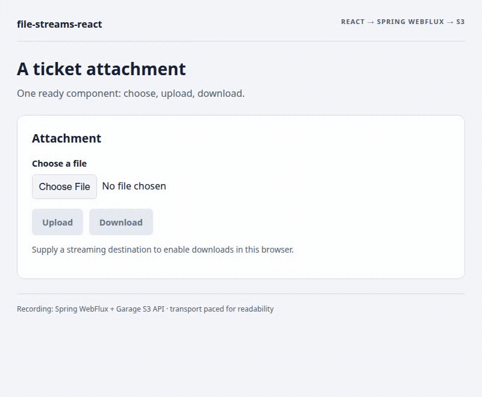
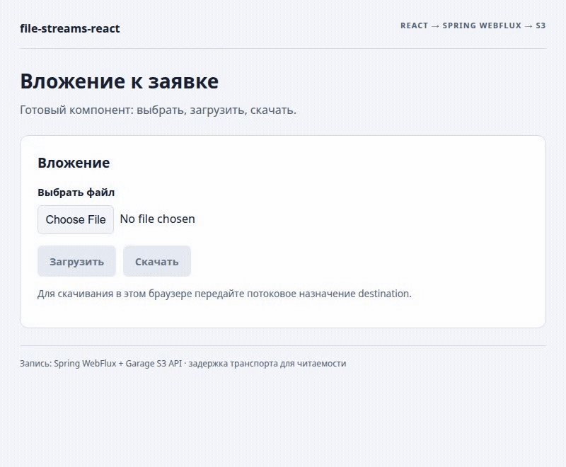

# file-streams-react

<details name="readme-language">
<summary><picture><source media="(prefers-color-scheme: dark)" srcset="assets/lang-en-dark.svg"></picture></summary>

Add an attachment control to an existing React screen: select a file, upload, cancel, and download confirmed content. `FileAttachment` includes the controls and feedback; your application supplies the account and object identity. Smaller components and hooks remain available for custom screens.

## Get started

Add these entries to your existing `package.json` dependencies. Keep your matching React/React DOM 18.3.1 or 19 versions.

```json
{
  "dependencies": {
    "@59alex/file-streams": "0.1.0",
    "@59alex/file-streams-react": "0.1.0"
  }
}
```

These packages are not yet published to npm; [local artifact setup](CONTRIBUTING.md) is available now. The coordinates above describe the intended package dependencies, not a verified registry release.

```tsx
import { FileAttachment } from '@59alex/file-streams-react';
import '@59alex/file-streams-react/styles.css';

export function TicketFiles({ accountId, ticketId }: {
  accountId: string; ticketId: string;
}) {
  return <FileAttachment scope={accountId} objectsUrl="/attachments"
    objectKey={`${accountId}:ticket-${ticketId}.txt`} />;
}
```

This example uses your same-origin `/attachments` business endpoint and the `attachments` size profile (64 MiB). Upload and download share one key. Configure the [Spring starter](https://github.com/dlorian59/file-streams-spring-boot-starter) for the same profile, or supply `objectsUrl` for another origin. The backend authorizes the key; the example's colon delimiter works with the default Spring Security firewall.

Download uses a native streaming save picker when supported. You can supply your own `destination`; unsupported browsers show an explanation rather than buffering a whole file. [Complete Spring/React integration](docs/integration/en.md) includes dependencies, configuration, file structure and runnable source.

<picture><source media="(prefers-reduced-motion: reduce)" srcset="assets/visuals/attachment-spring-en.png"></picture>

[Static image](assets/visuals/attachment-spring-en.png) · [Source](examples/spring-react/TicketAttachment.tsx) · [Recording details](docs/integration/en.md#run-and-record)

## Capabilities

**Show an already saved attachment.** Pass metadata from your application; a new upload is not required to enable download.

```tsx
<FileAttachment scope={accountId} objectsUrl="/attachments" objectKey={attachment.key}
  existingFile={attachment} />
```

`attachment` is an `UploadCommit` previously saved by the application. Mounting it does not call `onCommitted`. [Full example](examples/spring-react/TicketAttachment.tsx) · [Existing files](docs/integration/en.md#existing-files).

**Choose a size policy by name.** Keep large media transfers on their own policy without byte arithmetic.

```tsx
<FileAttachment scope={accountId} objectsUrl="/attachments" objectKey={fileKey} profile="media" />
```

Profiles: `attachments` 64 MiB, `media` 512 MiB, `archives` 16 GiB. Match the server's policy; `maxBytes` is an explicit override. [Options](docs/0.1.0/reference.en.md#ready-attachment-control).

**Handle an uncertain result explicitly.** Supply your application's reconciliation function when it can establish the final object outcome.

```tsx
<FileAttachment scope={accountId} objectsUrl="/attachments" objectKey={fileKey}
  reconcileUpload={checkFinalUploadOutcome} />
```

Cancel/lost response can leave an uploaded object. The control blocks another upload until reconciliation returns `absent`; `present` or `unknown` keeps it blocked. It never retries automatically. A single early 404 is not proof that an older request cannot still commit. [Callback contract and source](docs/integration/en.md#cancellation-and-retry).

**Keep your existing form and design system.** Use `FileUpload`, `FileDownload`, `TransferStatus`, or hooks. The optional `/react19` entry adds native form Actions.

```tsx
const upload = useFileUpload({ objectsUrl, scope: accountId,
  maxBytes: fileProfiles.attachments.maxBytes });
```

Import both names from `@59alex/file-streams-react`. [Every component in action](docs/visuals/en.md) · [React 19 source](examples/visuals/ActionForm.tsx) · [API reference](docs/0.1.0/reference.en.md).

## Guides

[Spring/React integration](docs/integration/en.md) · [Visual examples](docs/visuals/en.md) · [Detailed guide](docs/0.1.0/en.md) · [API](docs/0.1.0/reference.en.md) · [Versions](docs/index.md) · [Verification](docs/VERIFICATION.md) · [Development](CONTRIBUTING.md) · [MIT](LICENSE)

The adapter uses continuous raw streams. Bytes read are not a commit; completion requires the matching server result. The recording used actual Spring WebFlux and Garage's S3 API with capture-only pacing and an OPFS destination replacing the OS dialog. It is not a performance or storage-failover benchmark.

</details>

<details name="readme-language" open>
<summary><picture><source media="(prefers-color-scheme: dark)" srcset="assets/lang-ru-dark.svg"></picture></summary>

Добавляет поле вложения на существующий React-экран: выбор файла, загрузку, отмену и скачивание подтверждённого содержимого. `FileAttachment` включает кнопки и обратную связь; приложение задаёт аккаунт и ключ объекта. Отдельные компоненты и hooks остаются доступными для своего интерфейса.

## Начало работы

Добавьте эти записи в dependencies существующего `package.json`. Сохраните используемые согласованные версии React/React DOM 18.3.1 или 19.

```json
{
  "dependencies": {
    "@59alex/file-streams": "0.1.0",
    "@59alex/file-streams-react": "0.1.0"
  }
}
```

Пакеты ещё не опубликованы в npm; сейчас доступно [подключение локальных артефактов](CONTRIBUTING.md). Координаты выше описывают зависимости пакетов, а не проверенный релиз в реестре.

```tsx
import { FileAttachment } from '@59alex/file-streams-react';
import '@59alex/file-streams-react/styles.css';

export function TicketFiles({ accountId, ticketId }: {
  accountId: string; ticketId: string;
}) {
  return <FileAttachment scope={accountId} objectsUrl="/attachments" language="ru"
    objectKey={`${accountId}:ticket-${ticketId}.txt`} />;
}
```

Пример использует бизнес-endpoint `/attachments` того же origin и профиль размера `attachments` (64 МиБ). Загрузка и скачивание работают с одним ключом. Задайте тот же профиль в [Spring-стартере](https://github.com/dlorian59/file-streams-spring-boot-starter) либо передайте `objectsUrl` для другого origin. Сервер проверяет доступ к ключу; разделитель-двоеточие из примера совместим со стандартным Spring Security firewall.

Для скачивания используется нативный потоковый save picker, когда он поддерживается. Можно передать своё `destination`; неподдерживаемый браузер показывает объяснение, не собирая полный файл в памяти. [Полная интеграция Spring/React](docs/integration/ru.md) содержит зависимости, конфигурацию, структуру файлов и запускаемый исходник.

<picture><source media="(prefers-reduced-motion: reduce)" srcset="assets/visuals/attachment-spring-ru.png"></picture>

[Статичный кадр](assets/visuals/attachment-spring-ru.png) · [Исходник](examples/spring-react/TicketAttachment.tsx) · [Условия записи](docs/integration/ru.md#запуск-и-запись)

## Возможности

**Показать сохранённое вложение.** Передайте метаданные из приложения; для скачивания не требуется новая загрузка.

```tsx
<FileAttachment scope={accountId} objectsUrl="/attachments" objectKey={attachment.key}
  existingFile={attachment} language="ru" />
```

`attachment` — ранее сохранённый приложением `UploadCommit`. Его отображение не вызывает `onCommitted`. [Полный пример](examples/spring-react/TicketAttachment.tsx) · [Существующие файлы](docs/integration/ru.md#существующие-файлы).

**Выбрать политику размера по имени.** Отделите крупные медиафайлы своей политикой без арифметики байтов.

```tsx
<FileAttachment scope={accountId} objectsUrl="/attachments" objectKey={fileKey} profile="media" />
```

Профили: `attachments` 64 МиБ, `media` 512 МиБ, `archives` 16 ГиБ. Согласуйте политику с сервером; `maxBytes` явно переопределяет лимит. [Параметры](docs/0.1.0/reference.ru.md#готовый-компонент-вложения).

**Явно обработать неизвестный результат.** Передайте функцию приложения, если оно может установить окончательный результат сохранения объекта.

```tsx
<FileAttachment scope={accountId} objectsUrl="/attachments" objectKey={fileKey}
  reconcileUpload={checkFinalUploadOutcome} />
```

После отмены или потери ответа объект мог сохраниться. Новая загрузка заблокирована до результата сверки `absent`; `present` и `unknown` оставляют блокировку. Автоматических повторов нет. Один ранний 404 не доказывает, что старый запрос уже не сможет завершиться commit. [Контракт callback и исходник](docs/integration/ru.md#отмена-и-повтор).

**Сохранить свою форму и дизайн-систему.** Используйте `FileUpload`, `FileDownload`, `TransferStatus` или hooks. Отдельный entry `/react19` добавляет нативные Actions формы.

```tsx
const upload = useFileUpload({ objectsUrl, scope: accountId,
  maxBytes: fileProfiles.attachments.maxBytes });
```

Оба имени импортируются из `@59alex/file-streams-react`. [Все компоненты в работе](docs/visuals/ru.md) · [Исходник React 19](examples/visuals/ActionForm.tsx) · [Справочник API](docs/0.1.0/reference.ru.md).

## Руководства

[Интеграция Spring/React](docs/integration/ru.md) · [Визуальные примеры](docs/visuals/ru.md) · [Подробное руководство](docs/0.1.0/ru.md) · [API](docs/0.1.0/reference.ru.md) · [Версии](docs/index.md) · [Проверки](docs/VERIFICATION.md) · [Разработка](CONTRIBUTING.md) · [MIT](LICENSE)

Адаптер передаёт непрерывные raw-потоки. Прочитанные байты не равны commit; завершению нужен соответствующий результат сервера. Запись использовала настоящие Spring WebFlux и Garage S3 API с задержкой только для читаемости и OPFS вместо системного диалога. Это не измерение производительности или отказоустойчивости хранилища.

</details>
