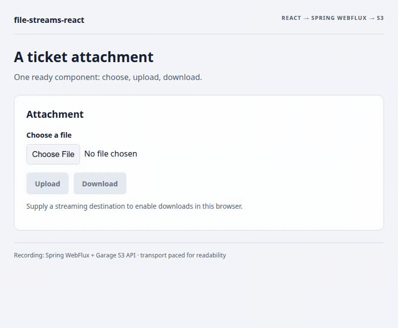

# A ticket attachment in an existing Spring and React application

[← README](../../README.md) · [API reference](../0.1.0/reference.en.md) · [Visual examples](../visuals/en.md) · [Русский](ru.md)

A support screen needs one attachment control. The application already knows the ticket, authenticated account and storage policy. `FileAttachment` adds file selection, transfer feedback, cancellation and download without application code for reading the file, wiring progress or closing the destination.

Use it for ticket attachments, documents and media files with an explicit size policy. Your application still owns authentication, the relationship between tickets and accounts, overwrite/version policy and any metadata it saves after upload.

## Files and dependencies

```text
existing-web-app/
  package.json
  src/tickets/TicketAttachment.tsx       # ready component integration
existing-spring-app/
  build.gradle.kts or pom.xml
  src/main/resources/application.yml
  src/main/java/.../AttachmentController.java
```

Frontend dependencies in the existing `package.json`:

```json
{"dependencies":{"@59alex/file-streams":"0.1.0","@59alex/file-streams-react":"0.1.0"}}
```

Keep the application's React/React DOM 18.3.1 or 19. The npm/Central artifacts are not yet published: [local npm artifacts](../../CONTRIBUTING.md) and the starter's [local consumer build](https://github.com/dlorian59/file-streams-spring-boot-starter/tree/main/examples/consumer) are the currently verified route.

Backend Gradle dependency, with your existing compatible Spring Boot dependency management:

```kotlin
dependencies {
    implementation("io.github.59alex:file-streams-spring-boot-starter:0.1.0")
}
```

Maven alternative:

```xml
<dependency>
  <groupId>io.github.59alex</groupId>
  <artifactId>file-streams-spring-boot-starter</artifactId>
  <version>0.1.0</version>
</dependency>
```

This starter brings Spring WebFlux and the streaming S3 adapter. The example uses Boot 4.1.2 and Java 17+, not Spring MVC. Keep the application's existing authentication chain; a browser-provided account ID is not authentication.

## Configure the server

```yaml
file-streams:
  enabled: true
  limits:
    profile: attachments
  s3:
    bucket: ${ATTACHMENTS_BUCKET}
    region: ${AWS_REGION}
  http:
    enabled: false
```

The named `attachments` profile matches the React default of 64 MiB per file. `http.enabled: false` disables the generic public `/objects` route: this application routes access through an authorized controller. AWS credentials remain on the server through the standard provider chain. For an S3-compatible service, configure its endpoint on the server; do not put credentials in React.

Use the full [AttachmentController.java](https://github.com/dlorian59/file-streams-spring-boot-starter/blob/main/examples/consumer/src/main/java/com/example/attachments/AttachmentController.java) and [application.yml](https://github.com/dlorian59/file-streams-spring-boot-starter/blob/main/examples/consumer/src/main/resources/application.yml). Its essential integration is:

```java
@RestController
public final class AttachmentController {
    private final ObjectStreamHandler files;
    public AttachmentController(ObjectStreamHandler files) { this.files = files; }

    @RequestMapping(path = "/attachments/{key}", method = {RequestMethod.PUT, RequestMethod.GET})
    public Mono<Void> transfer(@PathVariable("key") String key,
            Principal account, ServerWebExchange exchange) {
        if (account == null) return Mono.error(new ResponseStatusException(HttpStatus.UNAUTHORIZED));
        if (!account.getName().matches("[A-Za-z0-9_-]+") || !key.startsWith(account.getName() + ":")) {
            return Mono.error(new ResponseStatusException(HttpStatus.FORBIDDEN));
        }
        return files.handle(exchange, key);
    }
}
```

The linked source includes package/imports and EN/RU comments. Account-prefix checking illustrates a policy; replace or extend it with your ticket membership rules. Keep that check before reading the body. Keys use `account:filename` rather than encoded slashes, which the default Spring Security firewall rejects. The account identifier here is a stable URL-safe ID from the authenticated Principal.

For separate origins, explicitly allow the frontend's origin, PUT/GET, `Content-Type` and `X-Upload-Length`; expose `Content-Length`, `ETag`, `Accept-Ranges` and `Content-Range`. Keep the application's authentication/CSRF policy; supply its required headers through the component's `headers`, and change `scope` when access changes. Browser upload needs a working streaming path, normally HTTP/2 with TLS and compatible proxies.

## Mount the control

Full source: [TicketAttachment.tsx](../../examples/spring-react/TicketAttachment.tsx).

```tsx
import { FileAttachment } from '@59alex/file-streams-react';
import '@59alex/file-streams-react/styles.css';

export function TicketAttachment({ accountId, ticketId }: {
  accountId: string; ticketId: string;
}) {
  return <FileAttachment objectsUrl="/attachments" scope={accountId}
    objectKey={`${accountId}:ticket-${ticketId}.txt`} />;
}
```

No byte arithmetic, manual stream read or request handler is needed in this screen. Same-origin cookies use the transport's normal fetch policy. `scope` cancels and clears old work when the account changes; it is not sent as an authorization credential. If the authorization context changes without changing accounts, change the scope identifier too. Do not defer account scope changes in transitions.

| User action | Browser → Spring → storage | Visible outcome |
| --- | --- | --- |
| Select and upload | PUT `/attachments/account-42%3Aticket-123.txt`, raw body, `X-Upload-Length` | Byte counter shows source reads; no download yet |
| Wait | Adapter awaits storage and returns matching HTTP 201 `{committed,key,bytes,etag}` | Confirmed message; download becomes available |
| Download | GET of the same key; stream writes into the destination | Completion only after validated length and destination close |
| Cancel / lose response | Abort propagates, but storage may already have committed | Error/unknown outcome, no automatic retry |

The native save picker opens from the download click; it is not opened automatically after upload. If unsupported, the UI explains how to supply `destination`. You can pass a fresh `WritableStream` factory such as OPFS; see [streaming destination source](../../examples/visuals/transport.ts). No whole-file Blob fallback is used.

## Existing files

Pass an `existingFile: UploadCommit` from metadata the application saved earlier:

```tsx
<FileAttachment objectsUrl="/attachments" scope={accountId}
  objectKey={attachment.key} existingFile={attachment} fileName="invoice.pdf" />
```

The metadata key must match `objectKey`. Download is immediately available when the browser/destination supports it; mounting existing metadata does not invoke `onCommitted`. A selected replacement hides that download until the new upload commits. The application decides whether overwriting is permitted and persists new metadata using `onCommitted`. An ETag change resets the control's lifecycle; this is not an atomic conditional-write protocol. [Source](../../examples/spring-react/TicketAttachment.tsx).

## Cancellation and retry

A failed upload known not to have started/rejected permits an explicit retry with a fresh `file.stream()`. An `unknown` upload blocks file selection and retry until the application can establish the final result. The optional callback is:

```tsx
<FileAttachment objectsUrl="/attachments" scope={accountId} objectKey={fileKey}
  reconcileUpload={(key, signal) => applicationUploads.finalOutcome(key, signal)} />
```

`applicationUploads` is your existing domain service, not another library export. Its result is `Promise<'absent' | 'present' | 'unknown'>`. Only authoritative `absent` unlocks retry. `present` asks the user to inspect the object; `unknown`, thrown errors and cancelled checks never unlock it. `signal` is aborted when the control unmounts or changes ownership. The callback belongs to application policy because the generic stream protocol cannot distinguish every late commit from a definitive absence. A single early GET/HEAD 404 is insufficient if an old request can still commit.

The ready control implementation is [attachment.tsx](../../src/attachment.tsx); [tests](../../test/transfers.test.mjs) exercise cancel → unknown → blocked retry → application-confirmed absence → fresh attempt, and account switching. If the application has no authoritative reconciliation, leave the callback unset: the UI keeps the uncertain retry blocked. Creating a new business object/key is a separate application decision.

## Options to adapt the screen

`profile="media"` selects 512 MiB; `profile="archives"` selects 16 GiB; `maxBytes` overrides the selected profile. Align these values with the backend and its authorization/storage quotas. Defaults are resource policies, not a guarantee that every deployment can accept that size.

`language="ru"`, `accept`, `fileName`, `className`, `headers`, `credentials`, `destination`, `disabled`, `onCommitted` and `onComplete` adapt the control without changing transfer mechanics. CSS is optional and scoped to `.fs-attachment`; importing it gives a ready initial appearance. Existing hooks and smaller components work without this stylesheet. [Complete prop reference](../0.1.0/reference.en.md#ready-attachment-control).

## Run and record

The checked local demo intentionally uses the starter's loopback `/objects` endpoint without application authentication. The production integration above instead uses the secured `/attachments` controller. The demo contains no authentication tokens and is not a replacement for your application's security configuration.

1. Follow the starter's [example configuration](https://github.com/dlorian59/file-streams-spring-boot-starter/blob/main/example/src/main/resources/application.yml) and [launcher](https://github.com/dlorian59/file-streams-spring-boot-starter/blob/main/scripts/run-example.sh). Use the normal `:example:run` with a working S3 service and standard server-side credentials; the alternate memory fixture does **not** verify S3.
2. Build local packages as described in [CONTRIBUTING](../../CONTRIBUTING.md). Start the frontend with `npm run demo:spring`; open `https://127.0.0.1:5173/?lang=en` or `?lang=ru`, accepting local development certificates as necessary. Nothing opens automatically.
3. To record headlessly, stop that frontend and run `npm run capture:attachment`. It owns/stops only the frontend and browser. You remain responsible for stopping the backend/storage.

```text
examples/spring-react/TicketAttachment.tsx  reusable screen integration
examples/spring-react/main.tsx             loopback demonstration entry
scripts/demo.mjs --spring                  frontend HTTPS server
scripts/capture-attachment.mjs             reproducible recording and assertions
```

<picture><source media="(prefers-reduced-motion: reduce)" srcset="../../assets/visuals/attachment-spring-en.png"></picture>

[Static image](../../assets/visuals/attachment-spring-en.png) · [Recorded example source](../../examples/spring-react/TicketAttachment.tsx)

The recorded run used real Spring WebFlux + Garage S3. Both EN/RU files contained 131072 bytes; browser OPFS reads matched the source, and the backend owner independently retrieved both objects directly with S3 SigV4 and matched SHA-256. The recorder delays real upload bytes for readability and substitutes only the OS picker with a real OPFS destination. It checks that the picker is called while user activation is present. No progress or successful response is fabricated. Storage failover and lost-ack recovery are outside this recording. [Verification](../VERIFICATION.md).

[← README](../../README.md) · [API](../0.1.0/reference.en.md) · [Русский](ru.md)
