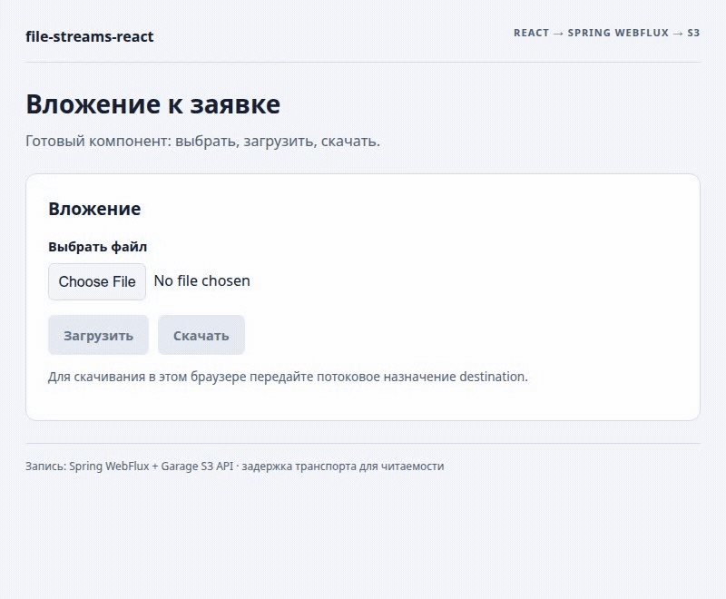

# Вложение к заявке в существующем приложении Spring и React

[← README](../../README.md) · [Справочник API](../0.1.0/reference.ru.md) · [Визуальные примеры](../visuals/ru.md) · [English](en.md)

Экрану поддержки нужно поле вложения. Приложение уже знает заявку, авторизованный аккаунт и политику хранения. `FileAttachment` добавляет выбор файла, состояния передачи, отмену и скачивание без кода приложения для чтения файла, подключения прогресса и закрытия назначения.

Компонент подходит для вложений к заявкам, документов и медиафайлов с явным лимитом размера. Приложение сохраняет ответственность за аутентификацию, связь заявки с аккаунтом, перезапись/версии и метаданные, которые оно сохраняет после загрузки.

## Файлы и зависимости

```text
existing-web-app/
  package.json
  src/tickets/TicketAttachment.tsx       # подключение готового компонента
existing-spring-app/
  build.gradle.kts или pom.xml
  src/main/resources/application.yml
  src/main/java/.../AttachmentController.java
```

Зависимости frontend в существующем `package.json`:

```json
{"dependencies":{"@59alex/file-streams":"0.1.0","@59alex/file-streams-react":"0.1.0"}}
```

Сохраните версии React/React DOM 18.3.1 или 19 своего приложения. Артефакты npm/Central ещё не опубликованы: сейчас проверены [локальные npm-архивы](../../CONTRIBUTING.md) и [локальная consumer-сборка стартера](https://github.com/dlorian59/file-streams-spring-boot-starter/tree/main/examples/consumer).

Зависимость Gradle для backend с существующим совместимым Spring Boot dependency management:

```kotlin
dependencies {
    implementation("io.github.59alex:file-streams-spring-boot-starter:0.1.0")
}
```

Альтернатива Maven:

```xml
<dependency>
  <groupId>io.github.59alex</groupId>
  <artifactId>file-streams-spring-boot-starter</artifactId>
  <version>0.1.0</version>
</dependency>
```

Стартер включает Spring WebFlux и потоковый S3-адаптер. Пример использует Boot 4.1.2 и Java 17+, не Spring MVC. Сохраните существующую цепочку аутентификации приложения; account ID из браузера сам по себе не является аутентификацией.

## Настроить сервер

```yaml
file-streams:
  enabled: true
  limits:
    profile: attachments
  s3:
    bucket: ${ATTACHMENTS_BUCKET}
    region: ${AWS_REGION}
  http:
    enabled: false
```

Профиль `attachments` совпадает с React-default: 64 МиБ на файл. `http.enabled: false` выключает общий публичный маршрут `/objects`: приложение направляет доступ через контроллер с проверкой прав. AWS credentials остаются на сервере в стандартной provider chain. Для S3-совместимого сервиса задайте endpoint на сервере; не помещайте credentials в React.

Возьмите полный [AttachmentController.java](https://github.com/dlorian59/file-streams-spring-boot-starter/blob/main/examples/consumer/src/main/java/com/example/attachments/AttachmentController.java) и [application.yml](https://github.com/dlorian59/file-streams-spring-boot-starter/blob/main/examples/consumer/src/main/resources/application.yml). Основная часть подключения:

```java
@RestController
public final class AttachmentController {
    private final ObjectStreamHandler files;
    public AttachmentController(ObjectStreamHandler files) { this.files = files; }

    @RequestMapping(path = "/attachments/{key}", method = {RequestMethod.PUT, RequestMethod.GET})
    public Mono<Void> transfer(@PathVariable("key") String key,
            Principal account, ServerWebExchange exchange) {
        if (account == null) return Mono.error(new ResponseStatusException(HttpStatus.UNAUTHORIZED));
        if (!account.getName().matches("[A-Za-z0-9_-]+") || !key.startsWith(account.getName() + ":")) {
            return Mono.error(new ResponseStatusException(HttpStatus.FORBIDDEN));
        }
        return files.handle(exchange, key);
    }
}
```

В исходнике по ссылке есть package/imports и комментарии EN/RU. Проверка префикса аккаунта иллюстрирует политику; замените или дополните её правилами доступа к заявке. Проверяйте права до чтения тела. Ключи используют `account:filename`, а не encoded slash, который отклоняет стандартный Spring Security firewall. Здесь account — стабильный URL-safe ID из аутентифицированного Principal.

Для разных origins явно разрешите origin frontend, PUT/GET, `Content-Type` и `X-Upload-Length`; откройте через CORS `Content-Length`, `ETag`, `Accept-Ranges`, `Content-Range`. Сохраняйте политику аутентификации/CSRF приложения; нужные заголовки передавайте в `headers`, меняйте `scope` при изменении доступа. Для браузерной загрузки нужен рабочий потоковый путь, обычно HTTP/2 с TLS и совместимые proxy.

## Подключить компонент

Полный исходник: [TicketAttachment.tsx](../../examples/spring-react/TicketAttachment.tsx).

```tsx
import { FileAttachment } from '@59alex/file-streams-react';
import '@59alex/file-streams-react/styles.css';

export function TicketAttachment({ accountId, ticketId }: {
  accountId: string; ticketId: string;
}) {
  return <FileAttachment objectsUrl="/attachments" scope={accountId} language="ru"
    objectKey={`${accountId}:ticket-${ticketId}.txt`} />;
}
```

На экране не нужны арифметика байтов, ручное чтение потока и request handler. Cookie того же origin используют обычную политику fetch транспорта. `scope` отменяет и очищает старую работу при смене аккаунта; он не отправляется как credential. Если область доступа изменилась без смены аккаунта, меняйте и scope. Не откладывайте смену аккаунта через transitions.

| Действие | Браузер → Spring → хранилище | Видимый результат |
| --- | --- | --- |
| Выбрать и загрузить | PUT `/attachments/account-42%3Aticket-123.txt`, raw body, `X-Upload-Length` | Счётчик показывает чтение источника; скачивание ещё недоступно |
| Дождаться | Адаптер ожидает storage и возвращает соответствующий HTTP 201 `{committed,key,bytes,etag}` | Подтверждение; скачивание становится доступным |
| Скачать | GET того же ключа; поток пишется в назначение | Успех только после проверки длины и закрытия назначения |
| Отмена / потеря ответа | Abort распространяется дальше, но storage мог уже сделать commit | Ошибка/unknown, без автоматического повтора |

Нативный save picker открывается по нажатию скачивания, а не автоматически после загрузки. Если он не поддерживается, UI объясняет, что нужно передать `destination`. Можно использовать фабрику нового `WritableStream`, например OPFS; см. [исходник потокового назначения](../../examples/visuals/transport.ts). Полного Blob fallback нет.

## Существующие файлы

Передайте `existingFile: UploadCommit` из метаданных, сохранённых приложением ранее:

```tsx
<FileAttachment objectsUrl="/attachments" scope={accountId}
  objectKey={attachment.key} existingFile={attachment} fileName="invoice.pdf" />
```

Ключ метаданных должен совпадать с `objectKey`. Скачивание сразу доступно при поддержке браузером/назначением; отображение existing metadata не вызывает `onCommitted`. Выбор замены скрывает это скачивание до commit новой загрузки. Приложение определяет допустимость перезаписи и сохраняет новые метаданные через `onCommitted`. Смена ETag сбрасывает lifecycle компонента; это не протокол атомарной условной записи. [Исходник](../../examples/spring-react/TicketAttachment.tsx).

## Отмена и повтор

После ошибки с известным not-started/rejected можно явно повторить передачу с новым `file.stream()`. При `unknown` выбор файла и повтор заблокированы, пока приложение не установит окончательный результат. Необязательный callback:

```tsx
<FileAttachment objectsUrl="/attachments" scope={accountId} objectKey={fileKey}
  reconcileUpload={(key, signal) => applicationUploads.finalOutcome(key, signal)} />
```

`applicationUploads` — существующий доменный сервис приложения, не экспорт библиотеки. Он возвращает `Promise<'absent' | 'present' | 'unknown'>`. Только достоверный `absent` открывает повтор. `present` предлагает проверить объект; `unknown`, исключения и отменённые проверки не снимают блокировку. `signal` отменяется при unmount или смене владельца. Callback относится к политике приложения: общий потоковый протокол не различает все поздние commit и окончательное отсутствие. Одного раннего GET/HEAD 404 недостаточно, если старый запрос ещё может сделать commit.

Реализация готового компонента: [attachment.tsx](../../src/attachment.tsx); [тесты](../../test/transfers.test.mjs) проверяют отмену → unknown → блокировку повтора → подтверждённое приложением отсутствие → новую попытку, а также смену аккаунта. Если надёжной сверки нет, не передавайте callback: UI сохраняет блокировку. Создание другого бизнес-объекта/ключа — отдельное решение приложения.

## Настройки экрана

`profile="media"` выбирает 512 МиБ; `profile="archives"` — 16 ГиБ; `maxBytes` переопределяет профиль. Согласуйте значения с backend и квотами доступа/хранения. Defaults задают ресурсную политику, а не обещают, что любое развёртывание примет такой размер.

`language="ru"`, `accept`, `fileName`, `className`, `headers`, `credentials`, `destination`, `disabled`, `onCommitted`, `onComplete` адаптируют UI без изменения передачи. CSS необязателен и ограничен `.fs-attachment`; импорт даёт готовый начальный вид. Существующие hooks и отдельные компоненты работают без этого stylesheet. [Полный справочник props](../0.1.0/reference.ru.md#готовый-компонент-вложения).

## Запуск и запись

Локальный demo намеренно использует loopback endpoint стартера `/objects` без аутентификации приложения. Production-интеграция выше использует защищённый контроллер `/attachments`. В demo нет токенов; он не заменяет конфигурацию безопасности приложения.

1. Используйте [конфигурацию примера стартера](https://github.com/dlorian59/file-streams-spring-boot-starter/blob/main/example/src/main/resources/application.yml) и [launcher](https://github.com/dlorian59/file-streams-spring-boot-starter/blob/main/scripts/run-example.sh). Запускайте обычный `:example:run` с рабочим S3 и стандартными серверными credentials; альтернативный memory fixture **не** проверяет S3.
2. Соберите локальные пакеты по [CONTRIBUTING](../../CONTRIBUTING.md). Запустите frontend через `npm run demo:spring`; откройте `https://127.0.0.1:5173/?lang=en` или `?lang=ru`, при необходимости приняв сертификаты разработки. Окна автоматически не открываются.
3. Для headless-записи остановите этот frontend и выполните `npm run capture:attachment`. Скрипт владеет и останавливает только frontend/browser. Backend/storage останавливает запустивший их оператор.

```text
examples/spring-react/TicketAttachment.tsx  повторно используемая интеграция экрана
examples/spring-react/main.tsx             вход локальной демонстрации
scripts/demo.mjs --spring                  HTTPS-сервер frontend
scripts/capture-attachment.mjs             воспроизводимая запись и проверки
```

<picture><source media="(prefers-reduced-motion: reduce)" srcset="../../assets/visuals/attachment-spring-ru.png"></picture>

[Статичный кадр](../../assets/visuals/attachment-spring-ru.png) · [Исходник записанного примера](../../examples/spring-react/TicketAttachment.tsx)

Запись использовала настоящие Spring WebFlux + Garage S3. Оба EN/RU файла содержали 131072 байта; чтение OPFS в браузере совпало с источником, а владелец backend отдельно получил оба объекта напрямую через S3 SigV4 и сверил SHA-256. Recorder задерживает реальные байты для читаемости и заменяет только системный picker настоящим OPFS-назначением. Проверяется вызов picker при активном user activation. Прогресс и успешные ответы не подделываются. Отказы storage и восстановление после потери ответа этой записью не проверяются. [Результаты проверок](../VERIFICATION.md).

[← README](../../README.md) · [API](../0.1.0/reference.ru.md) · [English](en.md)
