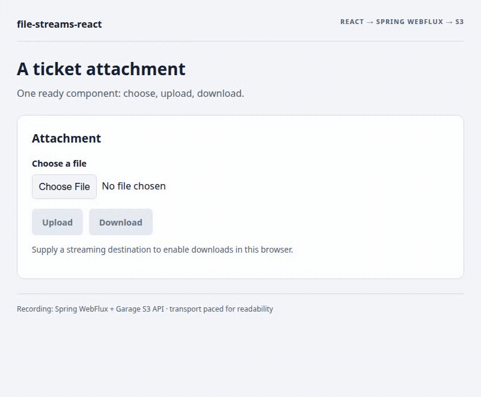
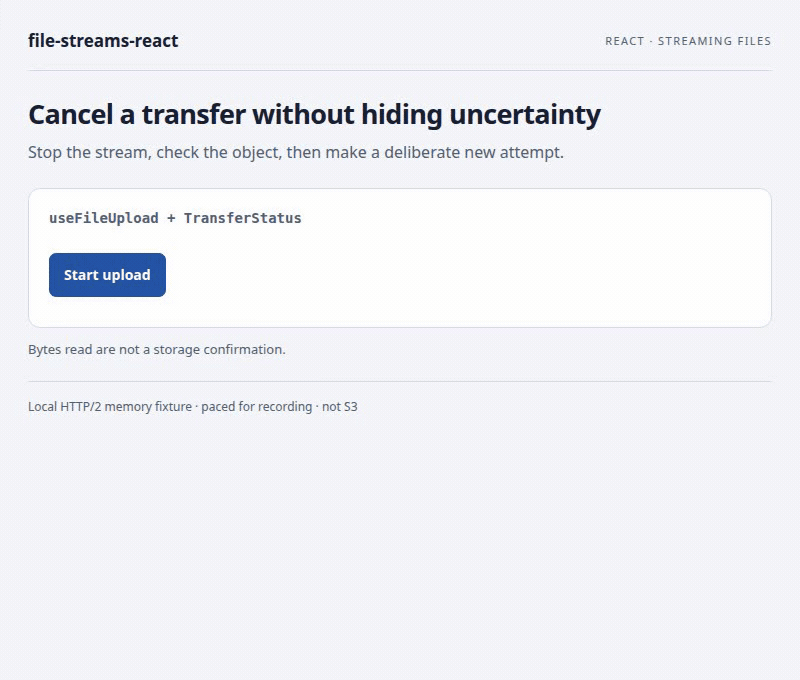
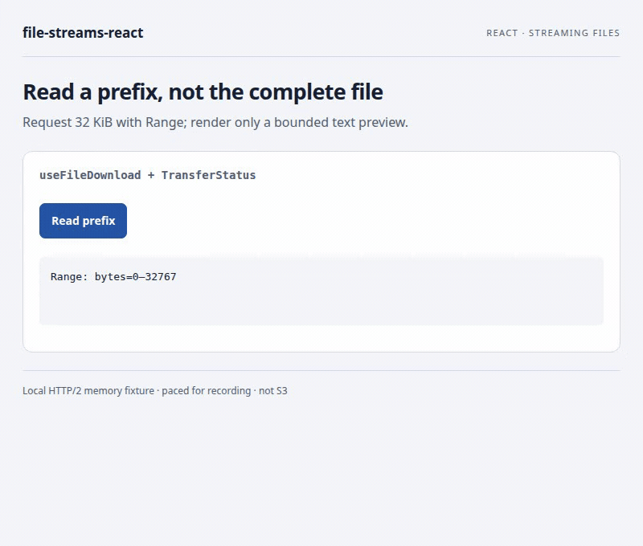
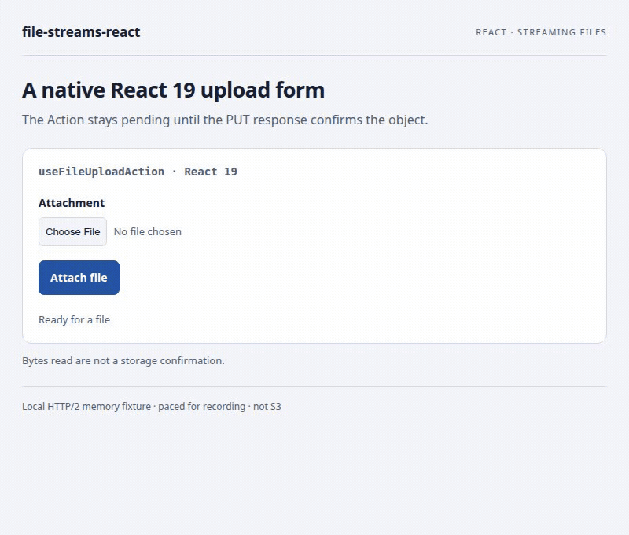

# See the file transfers in action

[← README](../../README.md) · [0.1.0 guide](../0.1.0/en.md) · [API reference](../0.1.0/reference.en.md) · [Русский](ru.md)

The ready `FileAttachment` recording uses actual **Spring WebFlux + Garage S3**. The four independent component/hook recordings use a local **bounded Node memory fixture**, not Spring or S3. Artificial source/transport delays make the states readable; the recordings are not performance measurements. No progress or commit result is drawn by the recorder. A small cursor marks real automated mouse actions; the native file chooser is not recorded, but the selected filename is visible.

| API | Scenario | What to look for |
| --- | --- | --- |
| [FileAttachment](#fileattachment) | Ready upload/download control | [Spring + React](../integration/en.md) |
| [FileUpload](#fileupload) | Select → upload → confirmation | A read counter at 100% still precedes commit |
| [FileDownload](#filedownload) | Download the confirmed object | Backpressure, byte progress, destination close |
| [TransferStatus](#transferstatus) | Cancel → uncertain result → check → retry | Failure is visible; cancellation does not promise rollback |
| [useFileUpload](#usefileupload) | Generated stream with custom controls | A fresh source for each deliberate attempt |
| [useFileDownload](#usefiledownload) | Bounded prefix preview | HTTP 206, requested range, checked byte count |
| [useFileUploadAction](#usefileuploadaction) | React 19 native form | Pending → confirmed result → file input reset |

Labels and exported option/result types configure these components; they do not render separate UI. Their full contracts are in the [reference](../0.1.0/reference.en.md).

## Run the examples

Prerequisites: Node 22.12+, npm, OpenSSL; sibling `file-streams/browser` checkout. For recording only: FFmpeg and the Playwright Chromium browser already installed for this package.

```bash
(cd ../file-streams/browser && npm ci && npm run build)
npm ci
npm run demo:visuals
```

Open `https://127.0.0.1:5181/?scenario=components&lang=en` and accept the local development certificate. The fixture uses HTTPS/HTTP2 on `127.0.0.1:19444`; open that origin once to accept its certificate too if needed. No browser opens automatically. Available scenarios: `components`, `upload`, `download`, `action`; use `lang=ru` for Russian. Ctrl+C stops both task-owned servers and discards fixture objects. Repeated runs may need a restart to clear previously uploaded objects before the cancel/check/retry demonstration.

For the actual Java integration, use the [paired Spring setup](../0.1.0/en.md#1-upload-an-attachment-and-receive-it-in-java). Replace the fixture URL with your authorized endpoint and omit the capture-only `fetch` pacing helper. Supply a synchronous account `scope`. These examples do not provide production authentication, overwriting policy or a storage reconciliation API.

## FileAttachment

[Ready FileAttachment: full Spring/React integration](../integration/en.md). The ready control combines upload/download with default attachments limits and optional styles. This recording used actual Spring WebFlux + Garage S3, unlike the independent memory fixtures below.

```tsx
import { FileAttachment } from '@59alex/file-streams-react';
import '@59alex/file-streams-react/styles.css';

export function Attachment() {
  return <FileAttachment objectsUrl="/attachments" scope="account-42"
    objectKey="account-42:invoice.pdf" language="en" />;
}
```

<picture><source media="(prefers-reduced-motion: reduce)" srcset="../../assets/visuals/attachment-spring-en.png"></picture>

[Static image](../../assets/visuals/attachment-spring-en.png) · [Runnable source](../../examples/spring-react/TicketAttachment.tsx)

## FileUpload

Select `architecture-notes.txt`, then press **Upload**. The ready-made component supplies a file input, progress, cancel and a commit callback. Browsers may read a small file in one visible step; the full bar is still `transferring` while the fixture delays confirmation. Download remains disabled until `onCommitted` runs.

<picture><source media="(prefers-reduced-motion: reduce)" srcset="../../assets/visuals/components-en.png"></picture>

[Static image](../../assets/visuals/components-en.png) · [Runnable integration source](../../examples/visuals/Components.tsx)

```tsx
import { FileUpload } from '@59alex/file-streams-react';

export function Attachment() {
  return <FileUpload objectsUrl="https://127.0.0.1:19444/objects"
    scope="demo-account" objectKey="tickets/42/attachment.txt" maxBytes={1024 * 1024}
    onCommitted={commit => console.info('Confirmed object', commit.key, commit.etag)} />;
}
```

Use this for an attachment field when the rest of the form should not implement stream ownership, progress and commit checks. `accept` filters the native chooser; it is not server-side content validation.

## FileDownload

The second half of the same recording shows **Download** becoming available after commit. The destination is an actual OPFS writable file, opened by the application; completion waits for its close. OPFS stores the file privately for this origin, so no OS “Save as” dialog appears. The [existing attachment example](../../examples/attachments/Attachments.tsx) shows a user-selected file destination instead.

<picture><source media="(prefers-reduced-motion: reduce)" srcset="../../assets/visuals/components-en.png"></picture>

[Static image](../../assets/visuals/components-en.png) · [Component source](../../examples/visuals/Components.tsx) · [Real streaming destination](../../examples/visuals/transport.ts)

```tsx
import { FileDownload } from '@59alex/file-streams-react';

async function openFile() {
  const directory = await navigator.storage.getDirectory();
  const file = await directory.getFileHandle('attachment.txt', { create: true });
  return file.createWritable();
}

export function DownloadAttachment() {
  return <FileDownload objectsUrl="https://127.0.0.1:19444/objects"
    scope="demo-account" objectKey="visual/attachment.bin" maxBytes={1024 * 1024}
    destination={openFile} />;
}
```

This removes repeated sink/progress/close plumbing. It does not add automatic resume or a whole-file Blob fallback. Browser destination support varies; provide a supported `WritableStream`.

## TransferStatus

`TransferStatus` renders the state supplied by either hook. In this recording it shows increasing byte progress, the actual `ABORTED / unknown` failure, then the confirmed result of a separate attempt. The retry button stays disabled until the application checks the object. A 404 from this local fixture is evidence for this example only, not a universal rollback guarantee.

<picture><source media="(prefers-reduced-motion: reduce)" srcset="../../assets/visuals/upload-en-cancelled.png"></picture>

[Static cancelled state](../../assets/visuals/upload-en-cancelled.png) · [Static confirmed state](../../assets/visuals/upload-en.png) · [Runnable source](../../examples/visuals/HookUpload.tsx)

```tsx
import { TransferStatus, englishLabels, type TransferState } from '@59alex/file-streams-react';
import type { UploadCommit } from '@59alex/file-streams';

export function UploadFeedback({ state }: { state: TransferState<UploadCommit> }) {
  return <TransferStatus state={state} labels={englishLabels}
    renderError={error => error instanceof Error ? error.message : 'Transfer failed'} />;
}
```

Idle renders nothing; unknown totals use indeterminate progress; success uses `role="status"`, failure uses `role="alert"`. A custom error renderer does not suppress the built-in uncertain-outcome warning. [Complete state/labels reference](../0.1.0/reference.en.md#components-and-text).

## useFileUpload

The [cancel/check/retry recording above](#transferstatus) comes from `useFileUpload`. Its source creates a paced byte stream for each attempt and declares the expected size. The hook handles one active operation, progress and cancellation; the application chooses its key and decides whether another attempt is appropriate.

```tsx
import { useFileUpload, TransferStatus } from '@59alex/file-streams-react';

export function GeneratedAttachment() {
  const transfer = useFileUpload({ objectsUrl: 'https://127.0.0.1:19444/objects',
    scope: 'demo-account', maxBytes: 8192 });
  async function send() {
    const source = new ReadableStream<Uint8Array>({
      start(controller) { controller.enqueue(new Uint8Array(8192)); controller.close(); },
    });
    try { await transfer.upload({ key: 'generated.bin', source, knownLength: 8192 }); }
    catch { /* Render the original error through transfer.state. */ }
  }
  return <>
    <button disabled={transfer.state.status === 'transferring'} onClick={() => { void send(); }}>Send</button>
    <button onClick={transfer.cancel}>Cancel</button>
    <TransferStatus state={transfer.state} />
  </>;
}
```

[Full source with reconciliation and delayed generation](../../examples/visuals/HookUpload.tsx). No automatic retry: a one-shot stream cannot be replayed. Query your application's object/version state when the result is unknown; changing `scope` or unmounting cancels old work.

## useFileDownload

This example requests only the first 32 KiB of the fixture's longer text object. The custom sink keeps that bounded prefix and renders three lines after the validated response and sink close. It avoids transferring the entire object just to show a preview.

<picture><source media="(prefers-reduced-motion: reduce)" srcset="../../assets/visuals/download-en.png"></picture>

[Static image](../../assets/visuals/download-en.png) · [Runnable source](../../examples/visuals/HookDownload.tsx)

```tsx
import { useState } from 'react';
import { useFileDownload, TransferStatus } from '@59alex/file-streams-react';

export function PrefixPreview() {
  const [text, setText] = useState('');
  const download = useFileDownload({ objectsUrl: 'https://127.0.0.1:19444/objects',
    scope: 'demo-account', maxBytes: 32768 });
  async function read() {
    let prefix = '';
    const decoder = new TextDecoder();
    const destination = new WritableStream<Uint8Array>({
      write(bytes) { prefix += decoder.decode(bytes, { stream: true }); },
      close() { prefix += decoder.decode(); },
    });
    try {
      await download.download('preview.txt', destination, { start: 0, end: 32767 });
      setText(prefix);
    } catch { /* The error remains in download.state. */ }
  }
  return <>
    <button disabled={download.state.status === 'transferring'} onClick={() => { void read(); }}>Read</button>
    <TransferStatus state={download.state} /><pre>{text}</pre>
  </>;
}
```

Byte ranges do not understand text boundaries and do not provide automatic resume. HTTP `206`, visible range/length/ETag headers and exact byte counts are required.

## useFileUploadAction

The optional React 19 entry connects a native form to the same raw PUT endpoint. The recorded action is a real form submission, not a click-handler imitation. Pending disables submit; the result is shown only after a checked commit, then React clears the file input.

<picture><source media="(prefers-reduced-motion: reduce)" srcset="../../assets/visuals/action-en.png"></picture>

[Static image](../../assets/visuals/action-en.png) · [Runnable source](../../examples/visuals/ActionForm.tsx)

```tsx
import { useFileUploadAction } from '@59alex/file-streams-react/react19';
import { TransferStatus } from '@59alex/file-streams-react';

export function AttachmentForm() {
  const upload = useFileUploadAction({ objectsUrl: 'https://127.0.0.1:19444/objects',
    scope: 'demo-account', objectKey: 'form/attachment.bin', maxBytes: 1024 * 1024 });
  return <form action={upload.formAction}>
    <input name="file" type="file" aria-label="Attachment" required disabled={upload.isPending} />
    <button disabled={upload.isPending}>Attach file</button>
    <TransferStatus state={upload.state} />
  </form>;
}
```

This is a client Action requiring JavaScript, not a Server Function. A resolved Action can contain a failed result; do not interpret pending=false or automatic field reset as storage success. See [queue/scope/error semantics](../0.1.0/reference.en.md#react-19-form-actions).

## Reproduce recordings and checks

Stop `demo:visuals` first so its two ports are free, then run:

```bash
npm run typecheck
npm run capture:visuals
```

[Capture script](../../scripts/capture-visuals.mjs) starts and stops its own servers and headless Chromium, records real interactions, exports GIF/PNG pairs and validates filenames, progress, confirmation ordering, cancelled outcomes, explicit retry, OPFS bytes and range metadata. Raw videos and `verification.json` stay in ignored `output/playwright/visuals/`; documentation assets are under `assets/visuals/`. Eight GIFs cover four scenarios in EN/RU, each limited to 2 MiB. Static links remain available if a viewer does not honor reduced-motion `<picture>` sources.

The fixture caps individual objects at 1 MiB, stored data at 4 MiB, eight keys and two concurrent uploads. It implements only the example's fixed start/end ranges and known-length uploads. [Fixture implementation](../../scripts/visual-demo.mjs). It does not test S3 durability, production auth, real OS file dialogs or network failure recovery. [Separate integration evidence](../VERIFICATION.md).

[← README](../../README.md) · [Versions](../index.md) · [Русский](ru.md)
