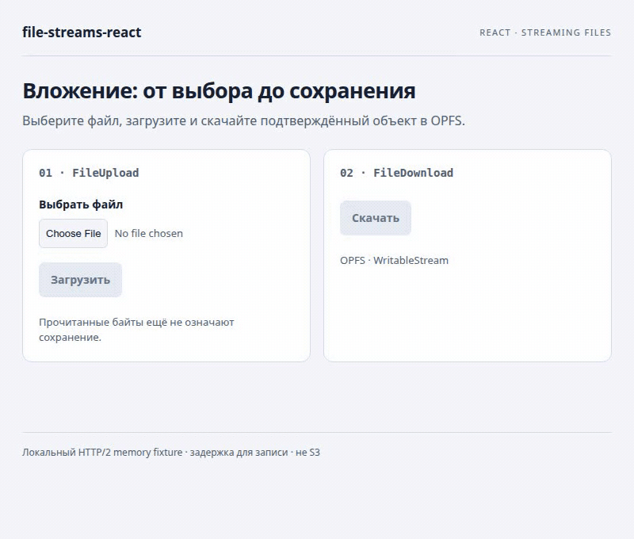
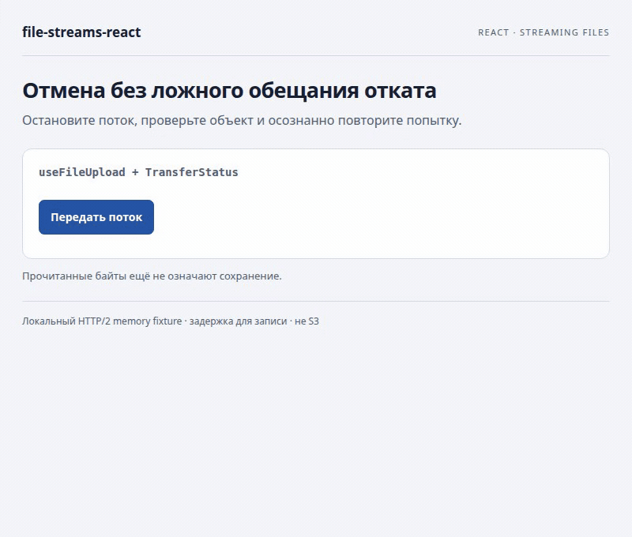
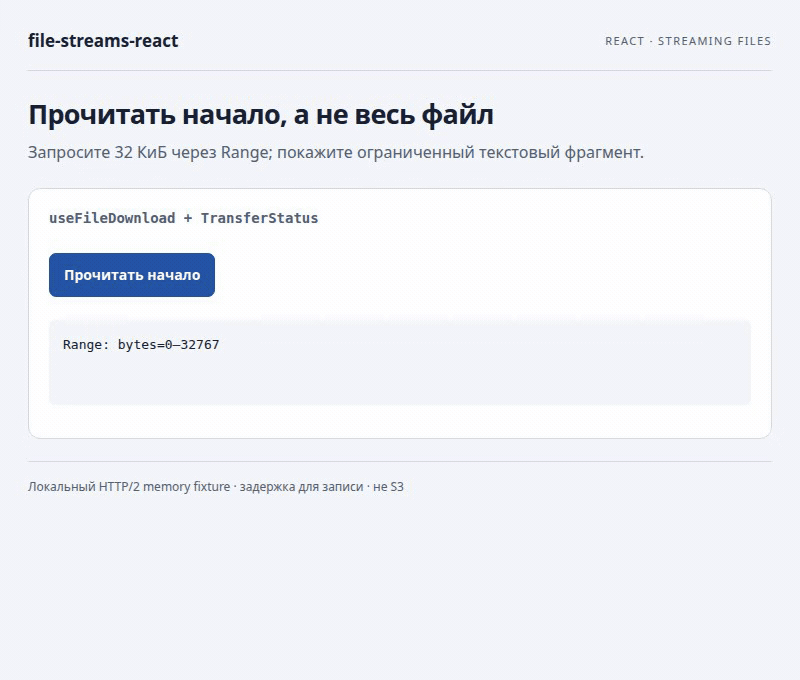
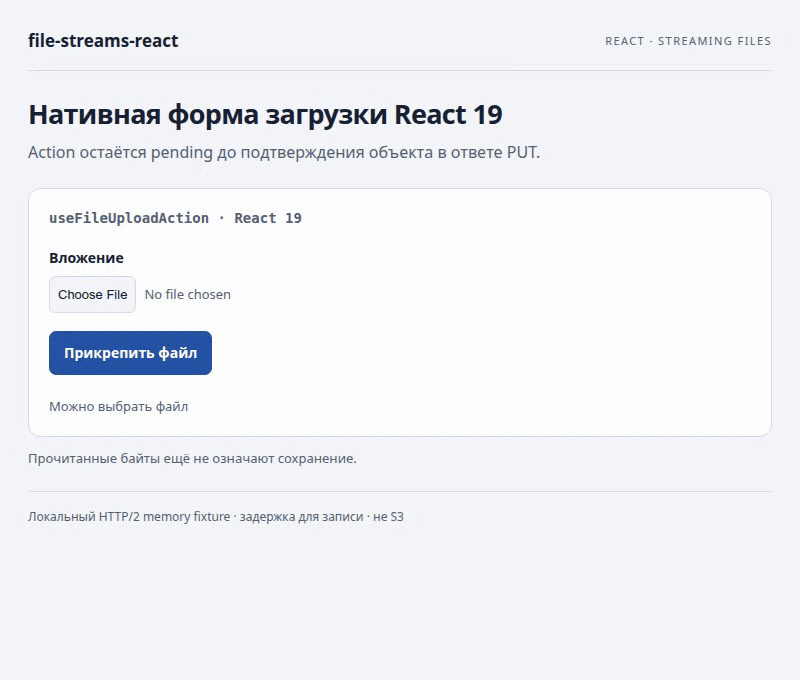

# Посмотреть передачу файлов в работе

[← README](../../README.md) · [Руководство 0.1.0](../0.1.0/ru.md) · [Справочник API](../0.1.0/reference.ru.md) · [English](en.md)

В записях настоящие React-компоненты выполняют HTTP/2-запросы к локальному **Node fixture с ограниченным хранилищем в памяти**. Это не Spring и не S3. Искусственные задержки источника/транспорта делают состояния различимыми; записи не измеряют производительность. Recorder не рисует прогресс или результат commit. Небольшой курсор отмечает реальные автоматизированные нажатия; системный диалог выбора не записан, но выбранное имя файла видно. Подписи native file input определяет браузер.

| API | Сценарий | На что смотреть |
| --- | --- | --- |
| [FileUpload](#fileupload) | Выбор → загрузка → подтверждение | Счётчик чтения 100% ещё предшествует commit |
| [FileDownload](#filedownload) | Скачивание подтверждённого объекта | Backpressure, прогресс байтов, закрытие назначения |
| [TransferStatus](#transferstatus) | Отмена → неизвестный результат → проверка → повтор | Ошибка видна; отмена не обещает откат |
| [useFileUpload](#usefileupload) | Генерируемый поток и свои кнопки | Новый источник для каждой осознанной попытки |
| [useFileDownload](#usefiledownload) | Ограниченный предпросмотр начала | HTTP 206, запрошенный диапазон, проверенное число байт |
| [useFileUploadAction](#usefileuploadaction) | Нативная форма React 19 | Pending → подтверждение → очистка поля файла |

Labels и экспортированные типы параметров/результатов настраивают эти компоненты, отдельного интерфейса у них нет. Их полные контракты описаны в [справочнике](../0.1.0/reference.ru.md).

## Запустить примеры

Нужны Node 22.12+, npm, OpenSSL и соседний checkout `file-streams/browser`. Только для записи нужны FFmpeg и уже установленный Chromium для Playwright этого пакета.

```bash
(cd ../file-streams/browser && npm ci && npm run build)
npm ci
npm run demo:visuals
```

Откройте `https://127.0.0.1:5181/?scenario=components&lang=ru` и примите локальный сертификат разработки. Fixture работает по HTTPS/HTTP2 на `127.0.0.1:19444`; при необходимости откройте и этот origin один раз, чтобы принять его сертификат. Окна браузера автоматически не открываются. Сценарии: `components`, `upload`, `download`, `action`; `lang=en` включает английский. Ctrl+C останавливает оба сервера и удаляет объекты fixture. Для повторной демонстрации отмены/проверки/повтора может потребоваться перезапуск, чтобы убрать объект, сохранённый предыдущим запуском.

Для настоящей интеграции Java используйте [парную настройку Spring](../0.1.0/ru.md#1-загрузить-вложение-из-react-и-принять-его-в-java). Замените URL fixture авторизованным endpoint и уберите `fetch` с задержкой для записи. Передавайте синхронно меняющийся `scope` аккаунта. Примеры не предоставляют production-авторизацию, политику перезаписи или API сверки состояния хранилища.

## FileUpload

Выберите `architecture-notes.txt` и нажмите **Загрузить**. Готовый компонент даёт выбор файла, прогресс, отмену и callback commit. Небольшой файл браузер может прочитать за один видимый шаг; заполненная полоса остаётся `transferring`, пока fixture задерживает подтверждение. Скачивание недоступно до вызова `onCommitted`.

<picture><source media="(prefers-reduced-motion: reduce)" srcset="../../assets/visuals/components-ru.png"></picture>

[Статичный кадр](../../assets/visuals/components-ru.png) · [Запускаемый исходник интеграции](../../examples/visuals/Components.tsx)

```tsx
import { FileUpload, russianLabels } from '@59alex/file-streams-react';

export function Attachment() {
  return <FileUpload objectsUrl="https://127.0.0.1:19444/objects"
    scope="demo-account" objectKey="tickets/42/attachment.txt" maxBytes={1024 * 1024}
    labels={russianLabels}
    onCommitted={commit => console.info('Подтверждён объект', commit.key, commit.etag)} />;
}
```

Подходит для поля вложения, когда остальная форма не должна реализовывать владение потоком, прогресс и проверку commit. `accept` фильтрует системный выбор, но не заменяет серверную проверку содержимого.

## FileDownload

Во второй части той же записи кнопка **Скачать** становится доступной после commit. Назначение — настоящий writable-файл OPFS, который открывает приложение; завершение ожидает его закрытия. OPFS хранит файл внутри origin, поэтому системного диалога «Сохранить как» нет. В [существующем примере вложения](../../examples/attachments/Attachments.tsx) показано назначение с выбором файла пользователем.

<picture><source media="(prefers-reduced-motion: reduce)" srcset="../../assets/visuals/components-ru.png"></picture>

[Статичный кадр](../../assets/visuals/components-ru.png) · [Исходник компонента](../../examples/visuals/Components.tsx) · [Потоковое назначение](../../examples/visuals/transport.ts)

```tsx
import { FileDownload, russianLabels } from '@59alex/file-streams-react';

async function openFile() {
  const directory = await navigator.storage.getDirectory();
  const file = await directory.getFileHandle('attachment.txt', { create: true });
  return file.createWritable();
}

export function DownloadAttachment() {
  return <FileDownload objectsUrl="https://127.0.0.1:19444/objects"
    scope="demo-account" objectKey="visual/attachment.bin" maxBytes={1024 * 1024}
    destination={openFile} labels={russianLabels} />;
}
```

Компонент убирает повторяющуюся обвязку назначения, прогресса и закрытия. Автоматического возобновления и полного Blob fallback нет. Поддержка назначений зависит от браузера; передайте поддерживаемый `WritableStream`.

## TransferStatus

`TransferStatus` показывает состояние любого из базовых hooks. В записи видны рост счётчика байтов, настоящая ошибка `ABORTED / unknown` и затем подтверждение отдельной попытки. Кнопка повтора недоступна, пока приложение не проверит объект. Ответ 404 локального fixture — свидетельство для этого примера, а не универсальная гарантия отката.

<picture><source media="(prefers-reduced-motion: reduce)" srcset="../../assets/visuals/upload-ru-cancelled.png"></picture>

[Статичная отмена](../../assets/visuals/upload-ru-cancelled.png) · [Статичное подтверждение](../../assets/visuals/upload-ru.png) · [Запускаемый исходник](../../examples/visuals/HookUpload.tsx)

```tsx
import { TransferStatus, russianLabels, type TransferState } from '@59alex/file-streams-react';
import type { UploadCommit } from '@59alex/file-streams';

export function UploadFeedback({ state }: { state: TransferState<UploadCommit> }) {
  return <TransferStatus state={state} labels={russianLabels}
    renderError={error => error instanceof Error ? error.message : 'Ошибка передачи'} />;
}
```

Idle ничего не рисует; неизвестный total даёт неопределённый прогресс; успех использует `role="status"`, ошибка — `role="alert"`. Свой renderer ошибки не скрывает встроенное предупреждение о неизвестном результате. [Полный контракт состояний и подписей](../0.1.0/reference.ru.md#компоненты-и-тексты).

## useFileUpload

[Запись отмены/проверки/повтора выше](#transferstatus) работает через `useFileUpload`. Её исходник создаёт замедленный поток для каждой попытки и объявляет ожидаемую длину. Hook ведёт одну активную операцию, прогресс и отмену; приложение выбирает ключ и решает, допустима ли новая попытка.

```tsx
import { useFileUpload, TransferStatus, russianLabels } from '@59alex/file-streams-react';

export function GeneratedAttachment() {
  const transfer = useFileUpload({ objectsUrl: 'https://127.0.0.1:19444/objects',
    scope: 'demo-account', maxBytes: 8192 });
  async function send() {
    const source = new ReadableStream<Uint8Array>({
      start(controller) { controller.enqueue(new Uint8Array(8192)); controller.close(); },
    });
    try { await transfer.upload({ key: 'generated.bin', source, knownLength: 8192 }); }
    catch { /* Исходная ошибка отображается через transfer.state. */ }
  }
  return <>
    <button disabled={transfer.state.status === 'transferring'} onClick={() => { void send(); }}>Передать</button>
    <button onClick={transfer.cancel}>Отменить</button>
    <TransferStatus state={transfer.state} labels={russianLabels} />
  </>;
}
```

[Полный исходник со сверкой состояния и постепенной генерацией](../../examples/visuals/HookUpload.tsx). Автоматического повтора нет: одноразовый поток нельзя переиграть. При неизвестном результате сверяйте состояние/версию объекта через приложение. Смена `scope` и unmount отменяют старую работу.

## useFileDownload

Пример запрашивает только первые 32 КиБ более длинного текстового объекта fixture. Свой sink хранит ограниченное начало и показывает три строки после проверки ответа и закрытия sink. Для предпросмотра не приходится передавать весь объект.

<picture><source media="(prefers-reduced-motion: reduce)" srcset="../../assets/visuals/download-ru.png"></picture>

[Статичный кадр](../../assets/visuals/download-ru.png) · [Запускаемый исходник](../../examples/visuals/HookDownload.tsx)

```tsx
import { useState } from 'react';
import { useFileDownload, TransferStatus } from '@59alex/file-streams-react';

export function PrefixPreview() {
  const [text, setText] = useState('');
  const download = useFileDownload({ objectsUrl: 'https://127.0.0.1:19444/objects',
    scope: 'demo-account', maxBytes: 32768 });
  async function read() {
    let prefix = '';
    const decoder = new TextDecoder();
    const destination = new WritableStream<Uint8Array>({
      write(bytes) { prefix += decoder.decode(bytes, { stream: true }); },
      close() { prefix += decoder.decode(); },
    });
    try {
      await download.download('preview.txt', destination, { start: 0, end: 32767 });
      setText(prefix);
    } catch { /* Ошибка остаётся в download.state. */ }
  }
  return <>
    <button disabled={download.state.status === 'transferring'} onClick={() => { void read(); }}>Прочитать</button>
    <TransferStatus state={download.state} /><pre>{text}</pre>
  </>;
}
```

Диапазоны байтов не учитывают границы текста и не обеспечивают автоматическое возобновление. Требуются HTTP `206`, видимые заголовки диапазона/длины/ETag и совпадение реального числа байт.

## useFileUploadAction

Дополнительный entry React 19 соединяет нативную форму с тем же raw PUT endpoint. В записи настоящая отправка формы, не имитация через click handler. Pending отключает submit; результат показывается только после проверенного commit, затем React очищает файловое поле.

<picture><source media="(prefers-reduced-motion: reduce)" srcset="../../assets/visuals/action-ru.png"></picture>

[Статичный кадр](../../assets/visuals/action-ru.png) · [Запускаемый исходник](../../examples/visuals/ActionForm.tsx)

```tsx
import { useFileUploadAction } from '@59alex/file-streams-react/react19';
import { TransferStatus, russianLabels } from '@59alex/file-streams-react';

export function AttachmentForm() {
  const upload = useFileUploadAction({ objectsUrl: 'https://127.0.0.1:19444/objects',
    scope: 'demo-account', objectKey: 'form/attachment.bin', maxBytes: 1024 * 1024 });
  return <form action={upload.formAction}>
    <input name="file" type="file" aria-label="Вложение" required disabled={upload.isPending} />
    <button disabled={upload.isPending}>Прикрепить файл</button>
    <TransferStatus state={upload.state} labels={russianLabels} />
  </form>;
}
```

Это клиентский Action с JavaScript, не Server Function. Завершённый Action может содержать ошибку; pending=false и очистка поля сами по себе не означают сохранение. См. [очередь, scope и ошибки](../0.1.0/reference.ru.md#actions-формы-react-19).

## Воспроизвести записи и проверки

Сначала остановите `demo:visuals`, чтобы освободить оба порта, затем:

```bash
npm run typecheck
npm run capture:visuals
```

[Скрипт записи](../../scripts/capture-visuals.mjs) сам запускает и останавливает серверы и headless Chromium, записывает реальные действия, экспортирует пары GIF/PNG и проверяет имя файла, прогресс, порядок подтверждения, результат отмены, явный повтор, байты OPFS и метаданные диапазона. Исходные видео и `verification.json` остаются в игнорируемом `output/playwright/visuals/`; иллюстрации документации — в `assets/visuals/`. Восемь GIF покрывают четыре сценария EN/RU, каждый ограничен 2 МиБ. Статичные ссылки доступны и в просмотрщиках без поддержки reduced-motion у `<picture>`.

Fixture ограничивает файл 1 МиБ, сохранённые данные 4 МиБ, число ключей восемью, параллельные загрузки двумя. Он реализует только нужные примеру диапазоны start/end и загрузки известной длины. [Реализация fixture](../../scripts/visual-demo.mjs). Записи не проверяют S3 durability, production-авторизацию, системные диалоги сохранения и восстановление после сетевых сбоев. [Отдельные результаты интеграции](../VERIFICATION.md).

[← README](../../README.md) · [Версии](../index.md) · [English](en.md)
